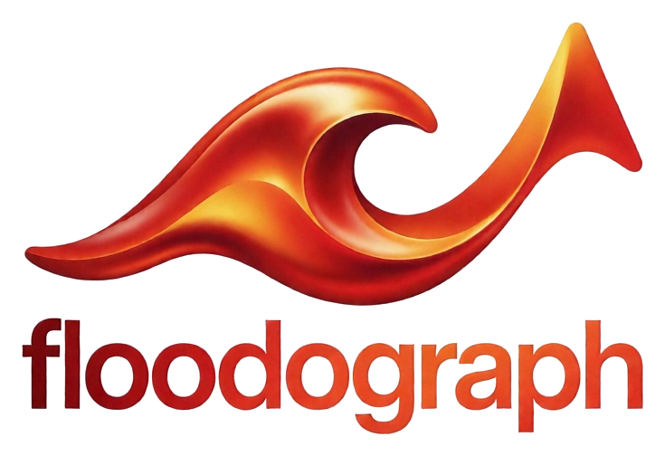

<p align="center">
  
</p>

<p align="center"><strong>Water always finds its way. We find it first.</strong></p>

<p align="center">
  
  
  
</p>

---

## Floodograph nedir?

Şehirlerdeki birçok derenin üstü kapatıldı, ama su eski yolunu unutmaz. Kuvvetli yağışta yine oradan akar ve oradaki binaları basar.

**Floodograph**, açık yükseklik verisinden bu kayıp ya da gömülü dereleri yeniden ortaya çıkarır. Gerçek yağış verisiyle sel anını 3D bir harita üzerinde saat saat simüle eder ve hangi binaya ne zaman su geleceğini gösterir.

## Ne yapacak? (MVP)

- 🗺️ **Gömülü dere ve su akış koridorları:** Yükseklik verisinden (Copernicus DEM) çıkarılır.
- 🌧️ **İki yağış modu:** Kaydırıcıyla senaryo ya da gerçek, anlık yağış.
- 🏙️ **3D sel simülasyonu:** 14 Ekim 2026 İstanbul selinin saat saat yeniden oynatılması.
- 🔁 **"Aynı yağış burada olsaydı":** İstanbul, İzmir ve Ankara.
- 🚦 **Aciliyet kademeleri:** Acil, yüksek, orta ve izle olarak önceliklendirilmiş müdahale listesi.

## Teknoloji

Python (hesaplama hattı) · Supabase (PostGIS) · Mapbox GL JS · React · Vercel · Open-Meteo

## Proje yapısı

```
backend/    hesaplama hattı ve simülasyon (Python)
frontend/   3D harita arayüzü (React, Mapbox)
docs/       sunum ve dokümantasyon
assets/     logo ve görseller
```

## Ekip: SALU

EkoZeka 2026 Hackathon (DEÜ CS-AI Topluluğu) için geliştiriliyor.

- Atakan Çalışkan
- Meriç Özkaya
- Funda Zeynep Şarkışla

## Veri kaynakları

Copernicus GLO-30 DEM · © OpenStreetMap katkıcıları (ODbL) · Open-Meteo · Mapbox

> Bu bir pilot çalışmadır, resmi bir sel risk haritası değildir.

## Lisans

[MIT](LICENSE)
